
> **ℹ️ Что получится**
>
> В Obsidian появится чат с ИИ-агентом на модели Xiaomi MiMo. Агент читает статью по ссылке, анализирует её, раскладывает на отдельные идеи и сохраняет результат заметкой. В конце мы соберём из этого навык: одна команда `/article-ideas <ссылка>` сделает всё сразу.

**Что понадобится**

- Компьютер с Windows 10 или 11 и [Obsidian](https://obsidian.md) 1.13 или новее. На телефоне Claudian не работает.
- Claude Code — программа-агент, которую Claudian запускает. Аккаунт и подписка Anthropic не нужны: запросы пойдут в MiMo по вашему ключу.
- Подписка MiMo Token Plan. Если у вас только карты российских банков, начните с раздела [2.2 Если есть только карты российских банков](#2-2-esli-est-tolko-karty-rossiyskikh-bankov): покупка через посредника может занять до суток.

## 0. Установить Claude Code

Claudian — это окно чата внутри Obsidian, а работу делает Claude Code. Его ставят отдельно, один раз.

1. Откройте PowerShell: нажмите клавишу **Win** (или кнопку «Пуск»), наберите `powershell` и нажмите **Enter**. Откроется окно, где строка начинается с `PS C:\Users\<ваше имя>>`. Права администратора не нужны.
2. Скопируйте команду, вставьте её в окно PowerShell (щелчок правой кнопкой мыши или `Ctrl+V`) и нажмите **Enter**:

   ```powershell
   irm https://claude.ai/install.ps1 | iex
   ```

   Установщик молча скачивает программу, это занимает минуту-две. Дождитесь, пока снова появится строка `PS C:\…>`.
3. Закройте окно PowerShell, откройте его заново тем же способом и проверьте установку:

   ```powershell
   claude --version
   ```

   Должен напечататься номер версии, например `2.1.304 (Claude Code)`.

Входить в аккаунт Anthropic не нужно: ключ MiMo мы зададим в Claudian.

> **⚠️ Если установщик отвечает ошибкой 403**
>
> Россия не входит в список стран, где работает Anthropic, поэтому сайт claude.ai может не отдать установщик. Тогда ставьте Claude Code через npm — так же советует инструкция MiMo:
> 1. Скачайте Node.js LTS с [nodejs.org](https://nodejs.org) (кнопка «Windows Installer (.msi)») и установите с настройками по умолчанию.
> 2. Откройте PowerShell заново и выполните `npm.cmd install -g @anthropic-ai/claude-code`.
> 3. Проверьте: `claude.cmd --version`.
>
> Окончание `.cmd` нужно потому, что PowerShell по умолчанию запрещает запуск скриптов `.ps1`, которые npm кладёт рядом. Без него будет ошибка «выполнение сценариев отключено в этой системе».

> **💡 Желательно, но не обязательно**
>
> Поставьте [Git for Windows](https://git-scm.com/downloads/win): с ним агент выполняет команды в Bash. Без него он работает через PowerShell.

## 1. Установить плагин Claudian

1. Откройте настройки Obsidian (шестерёнка слева внизу) → **Сторонние плагины**. В новом хранилище плагины сообщества выключены: нажмите **Выйти из ограниченного режима**.

   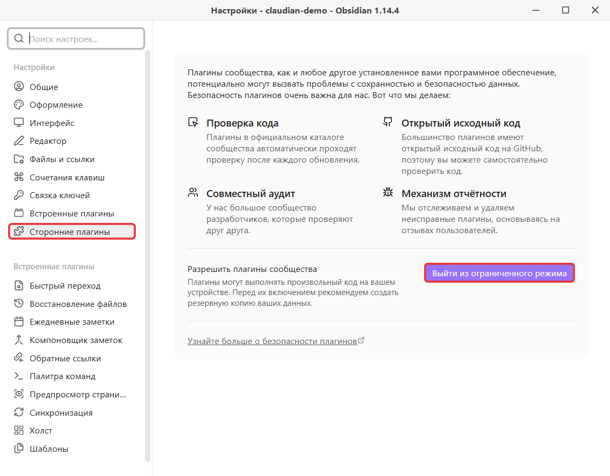{: width="650"}

2. Нажмите **Обзор** напротив «Плагины сообщества».

   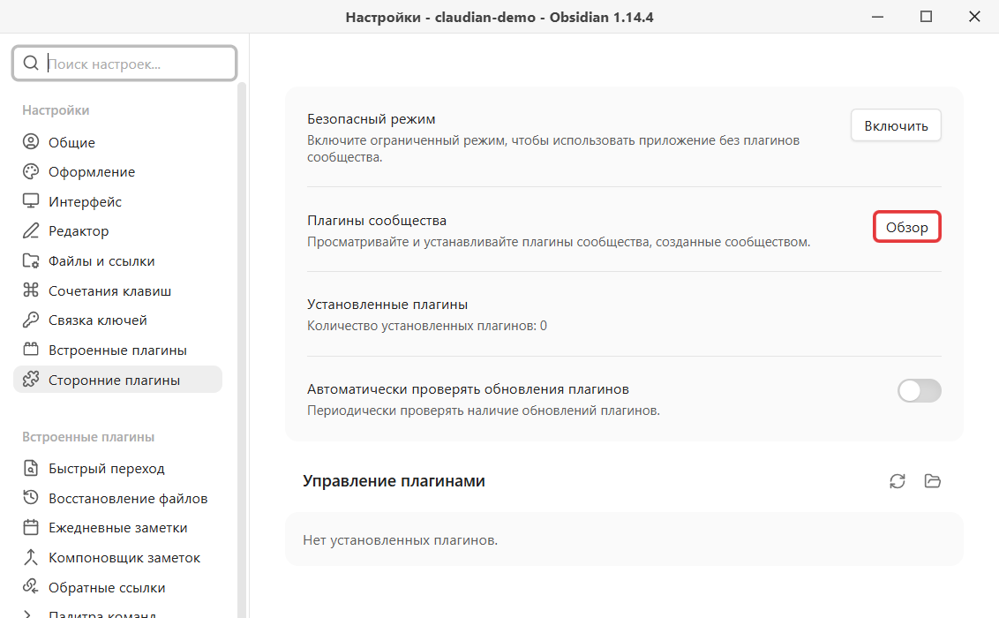{: width="650"}

3. Откроется отдельное окно каталога. Наберите в поиске `Claudian` и откройте плагин автора **Yishen Tu**. Рядом есть форки с похожими названиями (Claudian Plus, Oh My Claudian и другие), их не берите.

   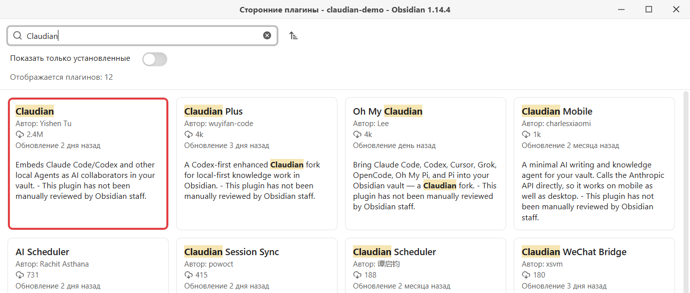{: width="650"}

4. Нажмите **Установить**.

   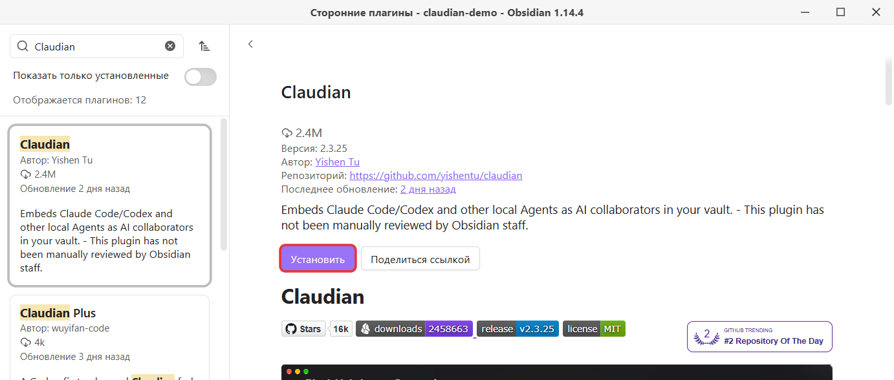{: width="650"}

5. После установки нажмите **Включить** и закройте окно каталога.

   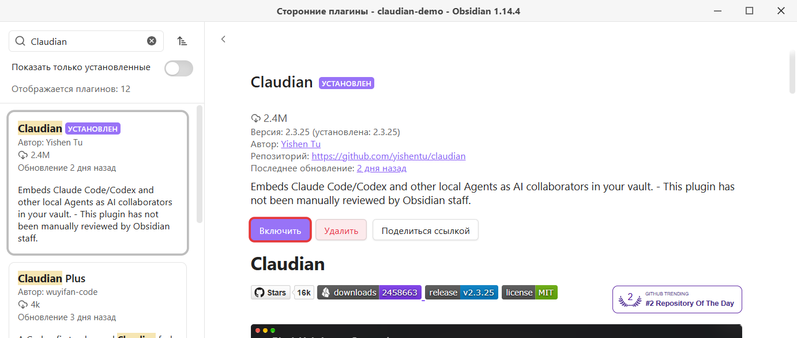{: width="650"}

6. Claudian по умолчанию говорит по-английски. В окне настроек слева, в самом низу списка, выберите **Claudian** → вкладка **General** → **Language** → **Русский**.

   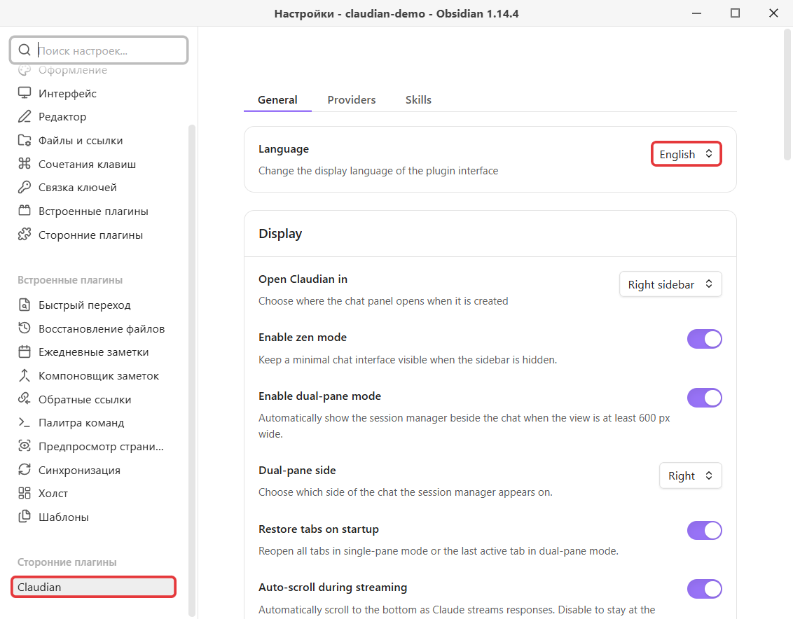{: width="650"}

7. Проверьте, что Claudian нашёл Claude Code: вкладка **Провайдеры** → **Claude Code**. В карточке должны быть версия и надпись «Определено автоматически». Красное «Нет включённых моделей» пока нормально: модели появятся в шаге 2.

   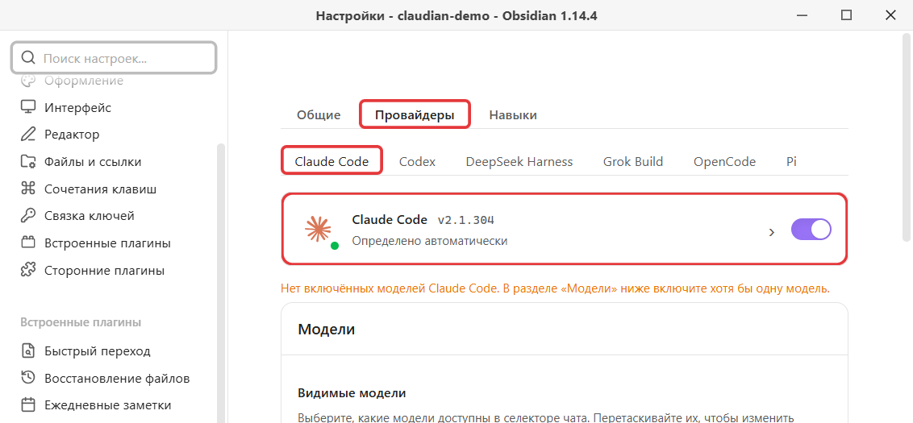{: width="650"}

> **⚠️ Если Claude Code не найден**
>
> Узнайте путь к программе: выполните в PowerShell `where.exe claude`. Раскройте карточку Claude Code (стрелка справа) и вставьте путь в поле «Путь к CLI Claude Code». Указывайте файл `claude.exe`, а не `.cmd` и не `.ps1`. Если ставили через npm, укажите файл `cli-wrapper.cjs` из папки `node_modules\@anthropic-ai\claude-code` (папку покажет команда `npm.cmd root -g`).

## 2. Подключить модель MiMo

### 2.1 Купить подписку

1. Зарегистрируйтесь на [platform.xiaomimimo.com](https://platform.xiaomimimo.com): по email или через Google.
2. Откройте раздел **Token Plan** и выберите тариф. В месяц: Lite — $6, Standard — $16, Pro — $50, Max — $100. На первую покупку скидка 12 %, возвратов нет (по [официальной странице](https://mimo.mi.com/docs/en-US/tokenplan/Token%20Plan/subscription) на 22.09.2026). Для начала хватит Lite.
3. Оплатите. Оплата идёт в долларах через платёжный сервис Waffo: банковская карта, Apple Pay или Google Pay.

<a id="2-2-esli-est-tolko-karty-rossiyskikh-bankov"></a>

### 2.2 Если есть только карты российских банков

Карты «Мир», а также Visa и Mastercard российских банков MiMo не примет, криптовалюту тоже. Что остаётся (проверено по сайтам на 20.10.2026):

1. **Карта зарубежного банка** — например, банка Казахстана, Армении или Киргизии. Самый надёжный путь: подписка оформляется на ваш аккаунт напрямую, без посредников.
2. **Готовая подписка на маркетплейсе.** На plati.market продают Token Plan за рубли, например [этот лот](https://plati.market/itm/5402811) (126 продаж на 20.10.2026). Продавец либо активирует подписку на вашем аккаунте — тогда ему нужны почта и пароль от аккаунта MiMo, — либо создаёт новый аккаунт на свою почту. Безопаснее первый вариант:
   - заведите отдельный аккаунт только под MiMo, с паролем, который больше нигде не используете;
   - после активации смените пароль;
   - выбирайте продавца с большим числом продаж и отзывов. До активации продавец возвращает 80 % суммы, после — ничего.
3. **Сервисы-посредники**, которые оплачивают зарубежные подписки за рубли, берут комиссию 5–20 %. Перед оплатой проверьте отзывы: сами мы их не проверяли.
4. **Без подписки — через российский агрегатор**, например [ProxyAPI](https://proxyapi.ru/docs/claude-code-proxyapi) или [AITUNNEL](https://aitunnel.ru/docs/claude-code). Оплата в рублях по факту расхода. Тогда в шаге 2.4 будут другие адрес, ключ и название модели: возьмите их из инструкции сервиса (у ProxyAPI модель называется `xiaomi/mimo-v2.6-pro`). С настоящим ключом агрегатора мы этот путь не проверяли.

### 2.3 Получить адрес и ключ

Откройте страницу [Token Plan](https://platform.xiaomimimo.com/#/console/plan-manage) в кабинете MiMo. Там ваш **Base URL** и **API Key** (ключ начинается с `tp-`). Base URL зависит от региона аккаунта: `https://token-plan-sgp.xiaomimimo.com/anthropic` (Сингапур), `https://token-plan-ams.xiaomimimo.com/anthropic` (Европа) или `https://token-plan-cn.xiaomimimo.com/anthropic` (Китай). Нужен адрес, который заканчивается на `/anthropic`.

> **❗ Ключ — как пароль**
>
> Claudian хранит его в файле `.claudian/claudian-settings.json` внутри хранилища. Если хранилище синхронизируется или вы им делитесь, ключ уйдёт вместе с ним.

### 2.4 Вписать переменные в Claudian

Настройки → **Claudian** → **Провайдеры** → **Claude Code** → прокрутите до раздела **Окружение**. В поле **Пользовательские переменные** вставьте строки ниже, подставив свои Base URL и ключ:

```
ANTHROPIC_BASE_URL=https://token-plan-ams.xiaomimimo.com/anthropic
ANTHROPIC_AUTH_TOKEN=tp-ваш-ключ
ANTHROPIC_MODEL=mimo-v2.6-pro[1m]
ANTHROPIC_DEFAULT_OPUS_MODEL=mimo-v2.6-pro[1m]
ANTHROPIC_DEFAULT_SONNET_MODEL=mimo-v2.6-pro
ANTHROPIC_DEFAULT_HAIKU_MODEL=mimo-v2.6-flash
CLAUDE_CODE_SUBAGENT_MODEL=mimo-v2.6-pro
```

Затем щёлкните мышью вне поля: Claudian сохраняет значение, когда поле теряет фокус.

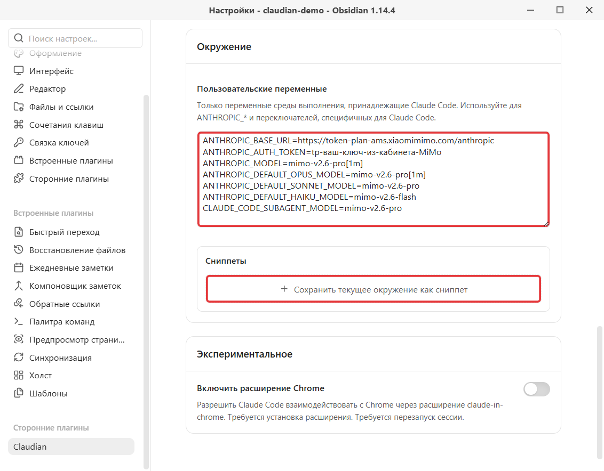{: width="650"}

| Строка | Зачем |
| --- | --- |
| `ANTHROPIC_BASE_URL` | куда отправлять запросы: в MiMo вместо Anthropic |
| `ANTHROPIC_AUTH_TOKEN` | ваш ключ MiMo |
| `ANTHROPIC_MODEL` | основная модель; `[1m]` — контекст в 1 млн токенов |
| `ANTHROPIC_DEFAULT_…_MODEL` | чем заменить модели Claude, которые Claude Code вызывает сам; например, «быструю» модель для названий чатов и чтения веб-страниц |
| `CLAUDE_CODE_SUBAGENT_MODEL` | модель для агентов-помощников |

Если у вас есть ещё и подписка Claude, сохраните переменные как сниппет: нажмите **Сохранить текущее окружение как сниппет** (на скриншоте выше обведено; когда сниппеты уже есть, это кнопка **+**), введите имя `MiMo` и нажмите **Сохранить**. Переменные подставятся из поля сами.

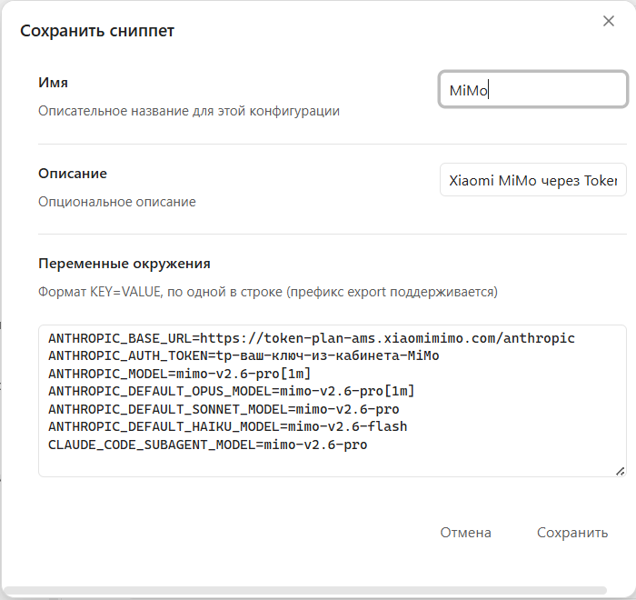{: width="500"}

Включить MiMo — кнопка **Вставить** (первый значок справа у сниппета): Claudian сразу заменит переменные и применит их. Вернуться к подписке Claude — очистить поле «Пользовательские переменные» и щёлкнуть вне его. После переключения начинайте новый чат: Claudian сбрасывает сессии открытых чатов.

### 2.5 Включить модель

Поднимитесь в том же разделе к блоку **Модели**. В «Обзоре моделей» нажмите **Обновить**: в списке появятся модели MiMo. Поставьте галочку у `mimo-v2.6-pro[1m]` с подписью «Custom model». Модель появится в блоке «Выбрано» с пометкой «По умолчанию», а красное предупреждение пропадёт.

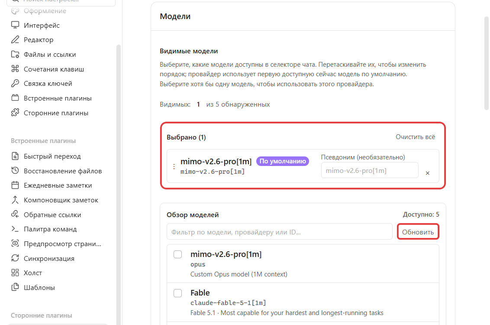{: width="650"}

### 2.6 Проверить

Закройте настройки и откройте чат: значок Claudian на левой панели или палитра команд (`Ctrl+P`) → «Claudian: Open chat view». Под полем ввода должна стоять модель `mimo-v2.6-pro[1m]`.

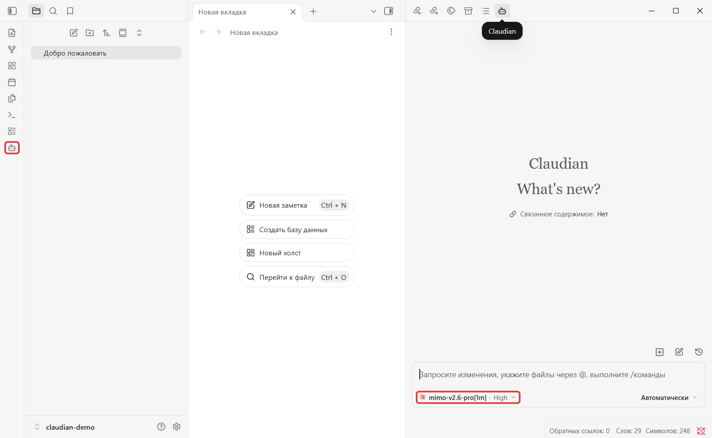{: width="650"}

Напишите «Привет! Ответь одним предложением.» и нажмите **Enter**. Если пришёл ответ, MiMo подключена.

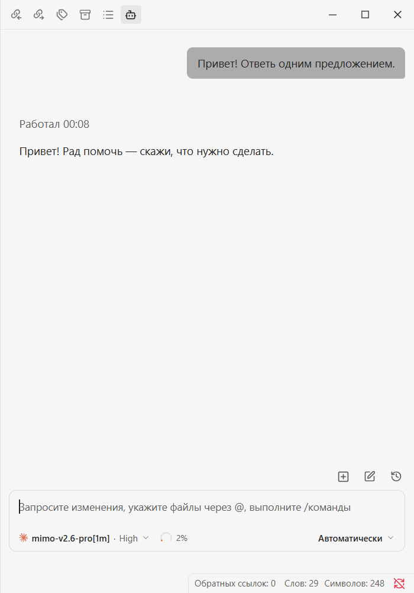{: width="420"}

## 3. Проанализировать статью по ссылке

Начните новый разговор (значок с карандашом над полем ввода) и отправьте запрос (ссылку замените на свою):

```
Прочитай статью и проанализируй её: https://perpetual-moose-185.notion.site/2026-2030-7-3ad2e2051c0c809aa246cf600688f5aa

1. О чём статья, кто автор, для кого написана — 2–3 предложения.
2. Главный тезис одной фразой.
3. Чем автор его подкрепляет: примеры, цифры, исследования.
4. Сильные стороны и слабые места: что спорно, что не подтверждено, где реклама.
5. Что из статьи можно применить на практике.
```

Агент сам решает, как прочитать страницу. Статьи на Notion обычная загрузка видит пустыми: текст там рисуется скриптами. Поэтому агент скачивает текст через внутренний API Notion. На это ушло около шести минут, в чате вся работа свёрнута в строку «Работал 05:38».

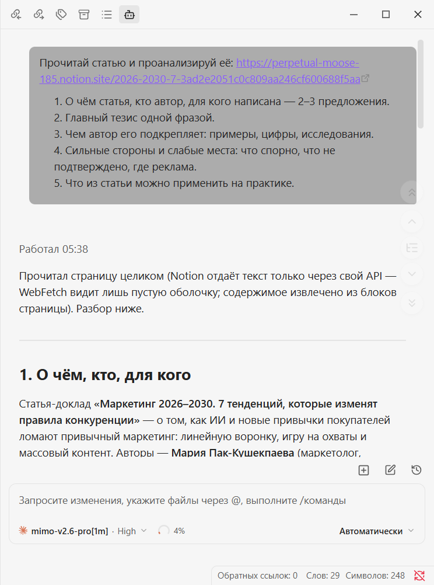{: width="500"}

Дальше идёт разбор по пяти пунктам. Хороший признак — агент не пересказывает статью, а оценивает её: на скриншоте он отметил, что проверяемых данных в статье нет. Ниже он отдельно разбирает рекламу: после каждой тенденции в статье стоит ссылка на платный вебинар.

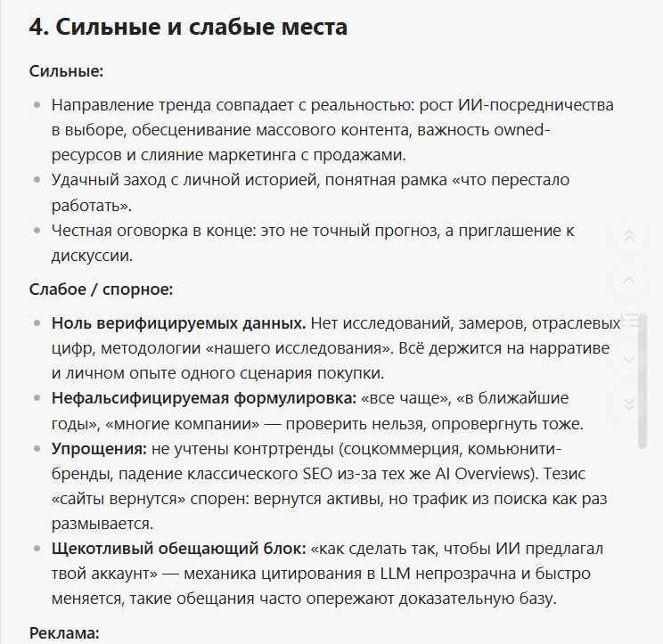{: width="500"}

## 4. Разобрать статью на отдельные идеи

В том же чате отправьте:

```
Теперь разбери статью на отдельные идеи:
- одна идея — одно законченное утверждение в 1–2 предложениях, понятное без статьи;
- иди по порядку статьи и группируй идеи по её разделам;
- под каждой идеей — короткая цитата из текста, на которую она опирается;
- если идея ничем не подкреплена, пометь её «(спорно)».
Сохрани результат в заметку «Маркетинг 2026–2030 — идеи.md» в корне хранилища: ссылка на статью, анализ из предыдущего ответа, идеи.
```

Через несколько минут агент сообщит, что заметка готова. Название заметки в ответе — ссылка, по ней заметка открывается.

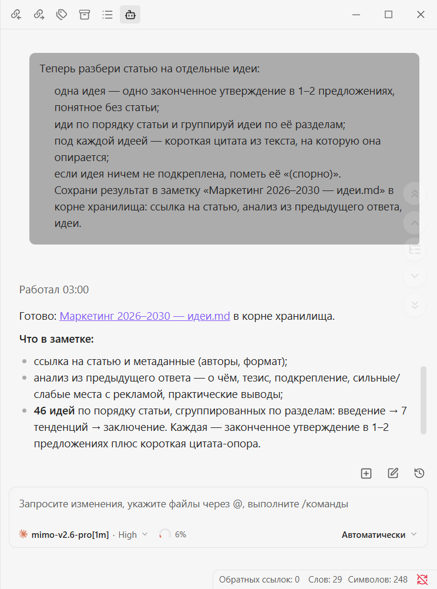{: width="500"}

В заметке три части: источник, анализ из шага 3 и идеи по разделам статьи. Под каждой идеей — цитата, на которую она опирается, а у идей без фактической опоры — пометка «(спорно)».

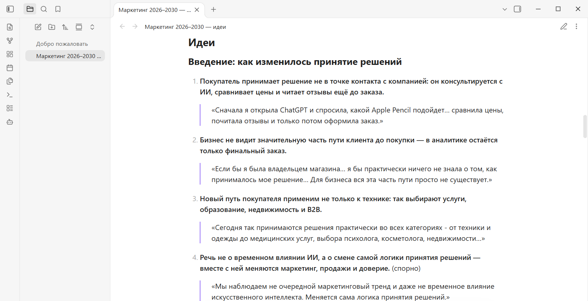{: width="700"}

> **💡 Проверьте выборочно**
>
> Модель может неточно процитировать или приписать статье то, чего в ней нет. Откройте статью и найдите 3–4 цитаты из заметки. В нашем прогоне 44 цитаты из 45 совпали с текстом дословно, в одной изменилось слово: «создать» вместо «создавать».

## 5. Сформулировать и использовать навык

**Навык** (skill) — это инструкция для агента в файле `.claude/skills/<имя>/SKILL.md` внутри хранилища. Вы один раз описываете процесс, а дальше запускаете его командой `/<имя>`, и результат каждый раз получается в одном формате.

### 5.1 Сформулировать

В том же чате, где разбирали статью, отправьте:

```
Оформи то, что мы сделали в этом чате, как навык Claude Code, чтобы дальше запускать всё одной командой.
- Файл .claude/skills/article-ideas/SKILL.md, вызов /article-ideas <ссылка>.
- Навык читает статью по ссылке. Опиши, как ты прочитал статью на Notion, — на случай, если обычная загрузка страницы вернёт пустоту.
- Анализ — по пяти пунктам из первого запроса, разбор на идеи — по правилам из второго.
- Результат — заметка «<Короткое название статьи> — идеи.md» в корне хранилища: ссылка, анализ, идеи.
- Запуск только вручную: в заголовке навыка disable-model-invocation: true.
Покажи итоговый SKILL.md.
```

Агент создаст папку `.claude/skills/article-ideas` и в ней файл `SKILL.md`, а в ответе кратко опишет, что внутри.

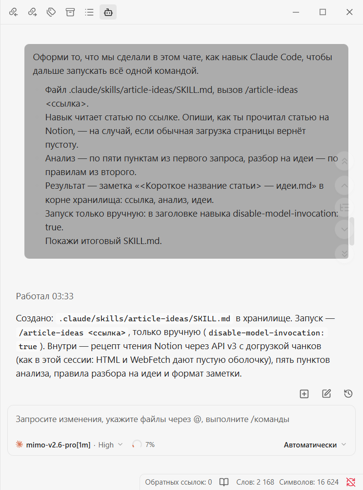{: width="500"}

Папка `.claude` скрыта: в списке файлов Obsidian её не видно, но Claude Code её читает. Открыть файл можно через Проводник Windows: `<папка хранилища>\.claude\skills\article-ideas\SKILL.md`.

Прочитайте навык. Если агент записал в него что-то лишнее или неточное, попросите поправить или поправьте сами: это обычный текстовый файл. Ниже навык из нашего прогона. Мы поменяли в нём три мелочи: убрали правила, которые попали туда из настроек компьютера, где делали демо, и разрешили вместо Python любой доступный язык — на чистой Windows Python обычно не установлен.

<details markdown="1">
<summary>📄 Итоговый SKILL.md</summary>

```markdown
---
name: article-ideas
description: Read an article by URL, produce a 5-point analysis and a section-by-section idea breakdown, save a note "<short title> — идеи.md" in the vault root. Manual only: /article-ideas <url>.
disable-model-invocation: true
---

# article-ideas

Аргумент команды: URL статьи ($ARGUMENTS). Обязателен; без URL — спросить и не продолжать.

Задача: прочитать статью по ссылке, сохранить в корень хранилища заметку «<Короткое название статьи> — идеи.md» с тремя секциями: Источник, Анализ, Идеи.

Заметку записывать инструментом Write по абсолютному пути.

## 1. Прочитать статью

1. Сначала WebFetch(url). Если текст есть — использовать его.
2. Если ответ пустой, содержит только «Notion» или SPA-оболочку — не останавливаться. Для Notion перейти к §1.1. Для обычного сайта попробовать curl + извлечь текст из HTML.

### 1.1 Notion: страница не отдаёт текст в HTML

Notion рендерится на клиенте: WebFetch и curl по URL возвращают только `<title>Notion</title>`. Публичный текст берётся из API v3 (body запросов — ASCII JSON, `curl -d` допустим).

1. Извлечь page_id: последний сегмент URL — 32 hex-символа. В API нужен UUID с дефисами формата 8-4-4-4-12 (например `3ad2e2051c0c809aa246cf600688f5aa` → `3ad2e205-1c0c-809a-a246-cf600688f5aa`).
2. Проверка доступа:
   `POST https://www.notion.so/api/v3/getPublicPageData`
   body: `{"type":"block-space","blockId":"<uuid>"}`
   `publicAccessRole:"reader"` — читать можно. Не `reader` — сообщить, что страница закрыта, и остановиться.
3. Загрузка блоков:
   `POST https://www.notion.so/api/v3/loadCachedPageChunk`
   body: `{"pageId":"<uuid>","limit":100,"cursor":{"stack":[]},"chunkNumber":0,"verticalColumns":false}`
   Ответ: `{cursor, recordMap.block}`. Пока `cursor.stack` непуст — повторять запрос с этим `cursor` (`chunkNumber`++), сливать `recordMap.block` в общий словарь. Часто нужно 2+ запроса: без догрузки первые ~100 дочерних блоков отсутствуют в recordMap.
4. Распаковка блока: `recordMap.block[id]` — вложенный объект вида `{value:{value:{…блок…},role}}`. Доставать блок, разворачивая `value`, пока ключи объекта — подмножество `{value, role}`.
5. Текст блока: `properties.title` — rich text; брать `seg[0]` каждого сегмента-списка. Структура страницы: DFS по `content[]` (список id дочерних блоков) от корневой `page`. Типы: `page`, `text`, `header`/`sub_header`/`sub_sub_header`, `bulleted_list_item`, `numbered_list_item`, `to_do`, `quote`, `callout`, `image`, `bookmark`, `embed`, `column_list`, `column`, `divider` и т.п. У `bookmark`/`embed` URL может быть в `properties.format` — сохранить в выписку.
6. Скрипт извлечения писать на том, что есть на компьютере: Python, Node.js или PowerShell. Записать его во временный файл инструментом Write и запускать файлом. Пути — Windows-стиль `C:/...`, не `/tmp`.

## 2. Анализ — пять пунктов

1. О чём статья, кто автор, для кого написана — 2–3 предложения.
2. Главный тезис одной фразой.
3. Чем автор его подкрепляет: примеры, цифры, исследования.
4. Сильные стороны и слабые места: что спорно, что не подтверждено, где реклама.
5. Что из статьи можно применить на практике.

## 3. Идеи

- Одна идея — законченное утверждение в 1–2 предложения, понятное без статьи.
- Идти по порядку статьи, группировать по её разделам (введение → разделы по порядку → заключение).
- Под каждой идеей — короткая цитата из текста, на которую она опирается (блок `> «…»`).
- Если идея ничем не подкреплена — в тексте только голословное утверждение или прогноз без фактов, цифр, примеров — пометить её «(спорно)» в конце формулировки. В начале заметки дать легенду, что означает пометка.

## 4. Заметка

Файл в корне хранилища: `<Короткое название статьи> — идеи.md` (короткое название — из заголовка, без воды; дефис — длинное тире `—`).

Структура:

1. `# <Название заметки>`
2. `## Источник` — ссылка на статью, авторы, тип материала.
3. `## Анализ` — пять пунктов из §2 (подзаголовки `### 1.` … `### 5.`).
4. `## Идеи` — по §3, группы = разделы статьи, идеи нумерованы внутри группы.
5. Футер: откуда взят текст и дата составления (дата — из системы, командой `date` или `Get-Date`, не наугад).
```

</details>

### 5.2 Использовать

Начните **новый** разговор (навыки подхватываются при старте разговора) и отправьте команду со ссылкой на другую статью:

```
/article-ideas https://www.sostav.ru/blogs/280930/98524
```

Когда начнёте набирать `/article`, Claudian подскажет команду из навыка.

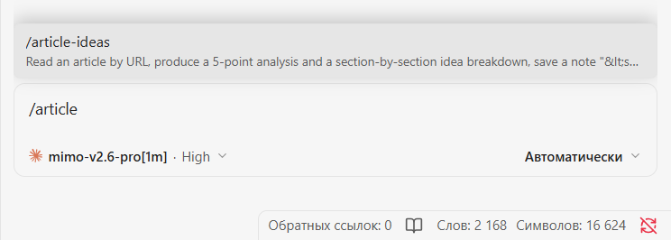{: width="500"}

Дальше агент работает сам: читает статью, анализирует, раскладывает на идеи и сохраняет заметку. В нашем прогоне это заняло около восьми минут.

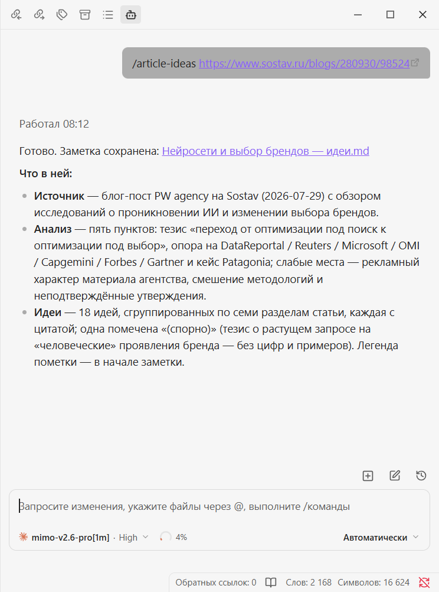{: width="500"}

Заметка устроена так же, как в шаге 4: источник, анализ, идеи с цитатами.

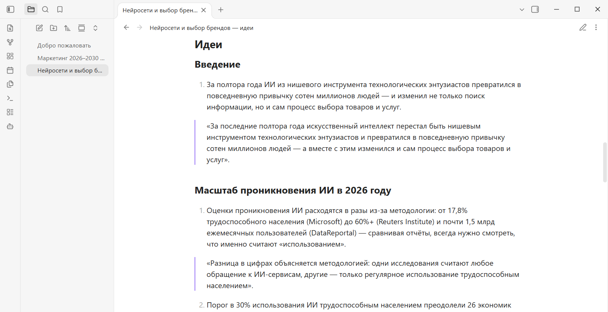{: width="700"}

Теперь любую статью можно разобрать одной командой: `/article-ideas <ссылка>`.

