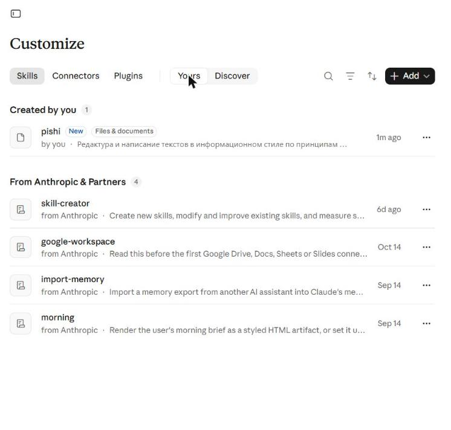
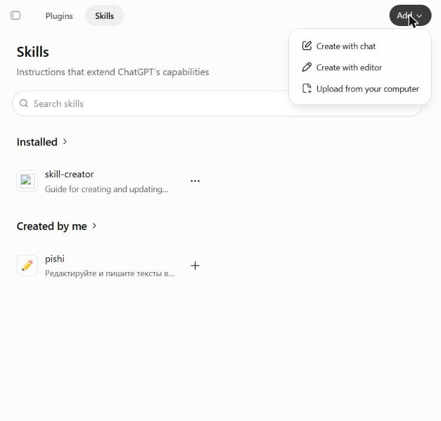
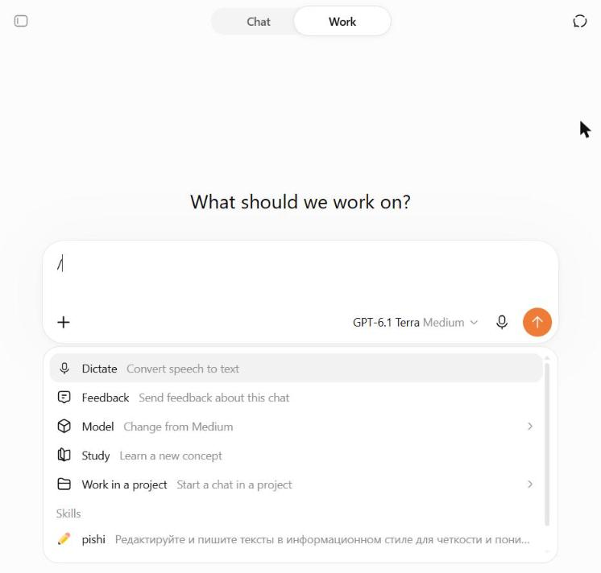
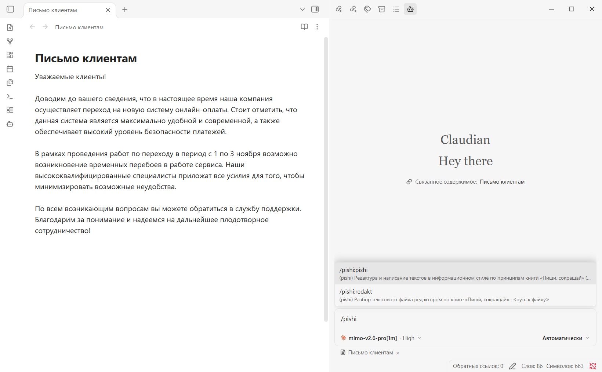
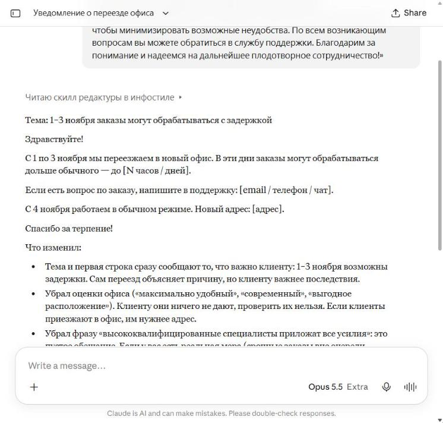
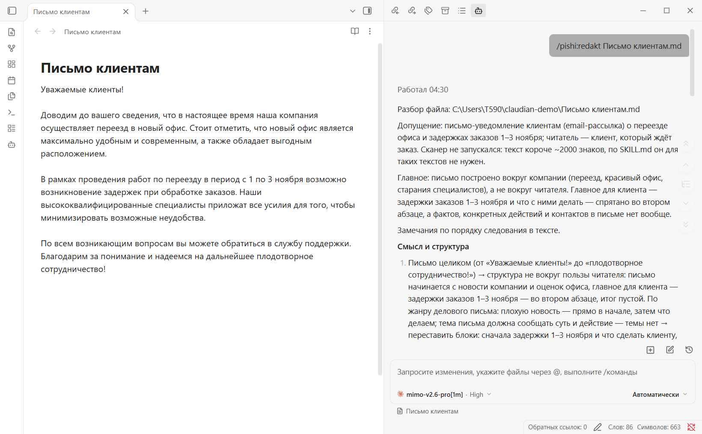
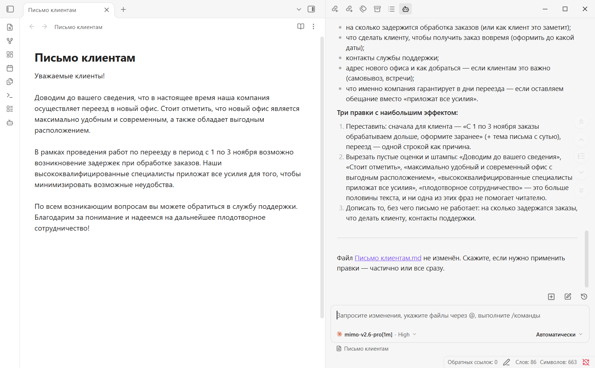
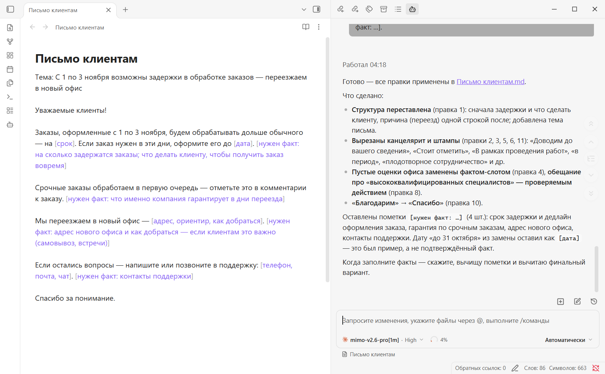


> **ℹ️ Что получится**
>
> ИИ-ассистент будет редактировать тексты по правилам книги М. Ильяхова и Л. Сарычевой «Пиши, сокращай». Он убирает канцелярит, штампы и пустые оценки, ставит главное в начало и объясняет, что изменил. Если для текста не хватает фактов, ассистент ставит пометку `[нужен факт: …]` и не придумывает цифры. В ChatGPT результат слабее — см. [2. Установить в ChatGPT](#2-ustanovit-v-chatgpt). Установка занимает около 5 минут.

Скилл `pishi` — набор правил, который ассистент читает перед работой с текстом. Установите его туда, где вы уже работаете:

| Где вы работаете | Что учесть | Раздел |
| --- | --- | --- |
| claude.ai в браузере | скилл подхватывается сам | [1. Установить в claude.ai](#1-ustanovit-v-claude-ai) |
| ChatGPT в браузере | нужен тариф с разделом Skills, режим Work и вызов `/pishi`; результат слабее, чем в Claude | [2. Установить в ChatGPT](#2-ustanovit-v-chatgpt) |
| Obsidian с Claudian или Claude Code | нужен Claude Code; есть команда `/pishi:redakt` для разбора заметок | [3. Установить в Claudian и Claude Code](#3-ustanovit-v-claudian-i-claude-code) |
| Codex CLI | только скилл, без `/pishi:redakt` | [4. Установить в Codex CLI](#4-ustanovit-v-codex-cli) |

Команды в инструкции даны для Windows. Исходники скилла — в репозитории [Kir-STR/pishi](https://github.com/Kir-STR/pishi).

<a id="1-ustanovit-v-claude-ai"></a>

## 1. Установить в claude.ai

> **⚠️ Без настройки Code execution скилл не загрузится**
>
> Проверьте, что включено **Settings** → **Capabilities** → **Code execution and file creation**. Обычно эта настройка включена.

1. Скачайте архив [pishi.zip](https://github.com/Kir-STR/pishi/releases/latest/download/pishi.zip). Распаковывать его не нужно.
2. Откройте [claude.ai/customize/skills](https://claude.ai/customize/skills). Нажмите **+ Add** → **Upload skill** и выберите `pishi.zip`.

   {: width="500"}

3. Откройте вкладку **Yours**. Скилл `pishi` появится в разделе **Created by you**.

   {: width="500"}

Как проверить — в разделе [5. Отредактировать текст](#5-otredaktirovat-tekst).

<a id="2-ustanovit-v-chatgpt"></a>

## 2. Установить в ChatGPT

> **⚠️ В ChatGPT скилл работает слабее, чем в Claude**
>
> ChatGPT подхватывает скилл, только если вызвать его командой `/pishi`. Сам он этого не делает ни в режиме **Chat**, ни в **Work**. Но и с вызовом ответ слабее. В нашем прогоне осталось пустое обещание «постараемся сократить задержки», пометок о недостающих фактах не было.

Раздел **Skills** есть не на всех тарифах ChatGPT; мы проверяли на Plus.

1. Скачайте архив [pishi.zip](https://github.com/Kir-STR/pishi/releases/latest/download/pishi.zip). Распаковывать его не нужно.
2. Откройте [chatgpt.com/skills](https://chatgpt.com/skills). Нажмите **Add** → **Upload from your computer** и выберите `pishi.zip`.

   {: width="500"}

3. Найдите `pishi` в разделе **Installed**. Если скилл есть только в **Created by me**, нажмите **+** рядом с ним — он появится в **Installed**.

   {: width="500"}

4. Откройте [chatgpt.com](https://chatgpt.com) и вверху страницы переключитесь в режим **Work**. В режиме **Chat** скилл не вызвать: меню со скиллами там нет.
5. Наберите в поле ввода `/` и выберите `pishi` в разделе **Skills**.

   {: width="500"}

6. Допишите запрос, например «Отредактируй письмо клиентам: …».

<a id="3-ustanovit-v-claudian-i-claude-code"></a>

## 3. Установить в Claudian и Claude Code

Нужен установленный Claude Code. Как его поставить — в разделе 0 инструкции [«Разбор статей на идеи: Obsidian + Claudian + MiMo»](https://kir-str.github.io/claudian-mimo/). Если вы ставили Claudian по ней, Claude Code у вас уже есть, и скилл будет работать на MiMo.

1. Откройте PowerShell: нажмите **Win**, наберите `powershell` и нажмите **Enter**.
2. Добавьте источник плагина:

   ```powershell
   claude plugin marketplace add Kir-STR/pishi
   ```

   В конце появится строка `✔ Successfully added marketplace: pishi`.
3. Установите плагин:

   ```powershell
   claude plugin install pishi@pishi
   ```

   Появится строка `✔ Successfully installed plugin: pishi@pishi (scope: user)`. Входить в аккаунт Anthropic не нужно.
4. В Obsidian начните в Claudian новый разговор.
5. Наберите `/pishi`. Появятся две команды: `/pishi:pishi` — сам скилл, `/pishi:redakt` — разбор заметки.

   {: width="650"}

В Claude Code в терминале шаги 1–3 заменяют две команды в чате: `/plugin marketplace add Kir-STR/pishi` и `/plugin install pishi@pishi`.

<a id="4-ustanovit-v-codex-cli"></a>

## 4. Установить в Codex CLI

Нужен установленный и подключённый к аккаунту [Codex CLI](https://learn.chatgpt.com/docs/codex/cli).

1. Откройте PowerShell.
2. Добавьте источник плагина:

   ```powershell
   codex plugin marketplace add Kir-STR/pishi
   ```

   Появится строка ``Added marketplace `pishi` from https://github.com/Kir-STR/pishi.git.``
3. Установите плагин:

   ```powershell
   codex plugin add pishi@pishi
   ```

   Появится строка ``Added plugin `pishi` from marketplace `pishi`.`` Скилл появится в Codex под именем `pishi:pishi`.

<a id="5-otredaktirovat-tekst"></a>

## 5. Отредактировать текст

В claude.ai, Claudian и Claude Code отдельная команда не нужна: попросите ассистента поработать с текстом, и он сам прочитает скилл. В ChatGPT начните запрос с `/pishi` — см. [2. Установить в ChatGPT](#2-ustanovit-v-chatgpt).

| Что нужно | Как попросить |
| --- | --- |
| Исправить текст | «Отредактируй письмо клиентам: …» |
| Понять, что не так, и переписать самому | «Разбери текст, дай комментарии: …» |
| Написать с нуля | «Напиши вакансию. Факты: …» |
| Уложиться в объём | «Сократи до 1000 знаков: …» |

**Как понять, что скилл сработал.** В claude.ai перед ответом появится строка «Читаю скилл редактуры в инфостиле», в Claudian — строка **Skill** с именем `pishi:pishi`. В ответе будут блоки «Что изменил» и «Нужны факты».

Для примера мы отправили в claude.ai письмо о переезде офиса с типичной водой: «доводим до вашего сведения», «максимально удобный» офис, «высококвалифицированные специалисты».

{: width="500"}

Ответ состоит из трёх частей:

- **Исправленный текст.** Главное для клиента — 1–3 ноября заказы могут задержаться — стоит в теме и первой строке.
- **«Что изменил».** Ассистент объясняет, почему убрал оценки и штампы.
- **«Нужны факты».** Ассистент перечисляет, чего не хватает: на сколько задержатся заказы, контакты поддержки, новый адрес. В тексте на этих местах стоят пометки в квадратных скобках.

> **💡 Заполните пометки сами**
>
> Скилл не придумывает цифры, сроки и имена. Пометки вроде `[нужен факт: …]` и `[адрес]` — вопросы к вам. Пока на них нет ответов, текст не готов.

## 6. Разобрать заметку командой /pishi:redakt

Команда есть только в Claudian и Claude Code. Она разбирает файл и предлагает правки, но сам файл не меняет.

1. Отправьте в Claudian команду с именем своей заметки. Если заметка лежит в папке, укажите путь от корня хранилища, например `Рассылки/Письмо клиентам.md`.

   ```
   /pishi:redakt Письмо клиентам.md
   ```

2. Дождитесь ответа: на MiMo разбор короткого письма занял около 4,5 минуты. Ответ начинается с главной проблемы текста, затем идут замечания по фрагментам в формате «цитата → в чём проблема → как исправить».

   {: width="650"}

   В конце — список недостающих фактов и три правки, которые дадут больше всего. Последняя строка подтверждает, что файл не изменён.

   {: width="650"}

3. Чтобы применить правки, напишите в том же разговоре:

   ```
   Примени все правки. Где не хватает фактов, оставь пометки [нужен факт: …].
   ```

   Агент перепишет заметку. На MiMo это заняло ещё около 4 минут.

   {: width="650"}

4. Впишите факты вместо пометок прямо в заметку и попросите: «Вычитай текст ещё раз».

## 7. Обновить скилл

Новые версии выходят на странице [релизов](https://github.com/Kir-STR/pishi/releases/latest).

- **claude.ai и ChatGPT.** Удалите старый скилл `pishi`. Затем скачайте новый [pishi.zip](https://github.com/Kir-STR/pishi/releases/latest/download/pishi.zip) и загрузите его, как в разделах 1 и 2.
- **Claudian и Claude Code.** Выполните в PowerShell `claude plugin update pishi@pishi`, затем перезапустите Obsidian. В Claude Code в терминале вместо перезапуска выполните в чате `/reload-plugins`.
- **Codex CLI.** Выполните `codex plugin marketplace upgrade pishi`, затем снова `codex plugin add pishi@pishi`.

## Если что-то пошло не так

- **Ассистент отредактировал текст, но не по скиллу.** В ответе нет «Что изменил» и пометок `[нужен факт: …]`. Напишите прямо: «Отредактируй по правилам „Пиши, сокращай“». В Claudian и Claude Code скилл вызывается командой `/pishi:pishi`, в ChatGPT — `/pishi`.
- **Claudian не показывает команды `/pishi`.** Проверьте в PowerShell, что плагин установлен: `claude plugin list` должен показать `pishi@pishi` со статусом `enabled`. Затем начните в Claudian новый разговор.
- **Ответ MiMo оборвался фразой `The request was rejected because it was considered high risk`.** Это ответ сервиса MiMo, а не скилла: MiMo отклонил запрос. У нас так оборвался разбор письма об онлайн-платежах. Если ошибка повторяется, отредактируйте этот текст в claude.ai: там то же письмо прошло без ошибок.

<details markdown="1">
<summary>📄 Claude Code видит два скилла pishi</summary>

Так бывает, если скилл загружен в claude.ai и стоит плагином в Claude Code. Claude Code подтягивает скиллы из аккаунта claude.ai и видит обе копии: `pishi:pishi` из плагина и `anthropic-skills:pishi` из claude.ai. Отключите копию из claude.ai:

1. Откройте в Блокноте файл `%USERPROFILE%\.claude\settings.json`.
2. Сразу после первой `{` вставьте строку с запятой в конце:

   ```json
   "skillOverrides": { "anthropic-skills:pishi": "off" },
   ```

   Если файла нет, создайте его с таким содержимым:

   ```json
   { "skillOverrides": { "anthropic-skills:pishi": "off" } }
   ```

Имя нужно полное: короткое `"pishi"` совпадает с именем скилла плагина, и копия из claude.ai остаётся включённой. Скилл плагина эта настройка не затрагивает.

</details>

